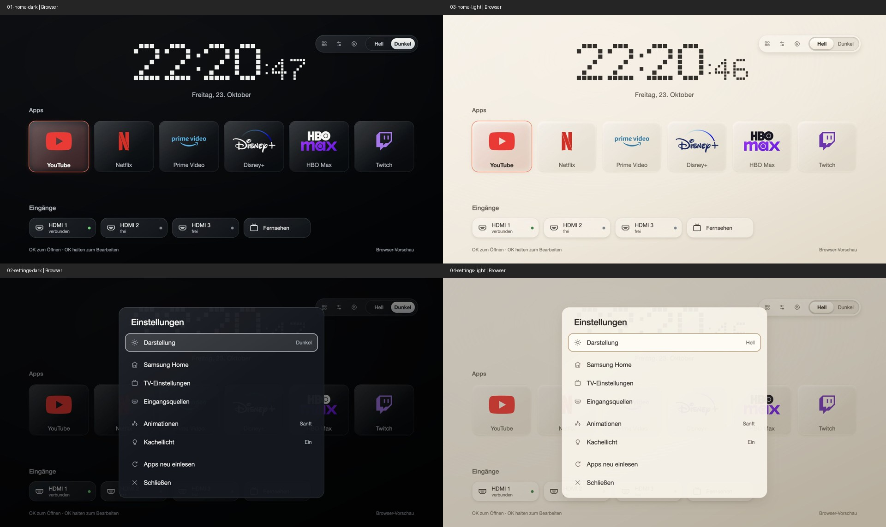

# Flix Home · experimental Tizen TV launcher

A quiet, remote-first launcher for older Samsung Tizen TVs. Version 0.5.3 uses
an actual fixed 5×7 square-pixel clock, separated transparent vector marks,
subtle glass cards and local focus light. The full-screen scene does not
change during app navigation. A two-label light/dark switch stays visible;
the light palette is warm beige. Favorites can be sorted/hidden with the remote.
No ads, feeds, remote servers or analytics. No continuously running PC is needed.

**This is a launchable TV app. Physical Home interception and reliable boot or
standby autostart are not implemented. It is not a full replacement TV OS.**
Samsung Home remains available from Settings and the physical remote.

## Compatibility and evidence

Development target: Samsung UE43NU7409 (2018), reported firmware
T-KTM2DEUC-1360.0, Tizen 4.0 / ARMv7 confirmed via SDB. The code targets its old
web engine: no ES modules, CSS grid, live backdrop blur or external fonts.
Other TVs are untested; this repository does not remove any firmware guards.

On the target, YouTube launch and Samsung Home return were physically confirmed.
Both 0.5.0 and 0.5.1 were installed and launched successfully. The owner confirmed
correct light/dark rendering and responsive navigation for 0.5.0, and correct
rendering and responsive navigation again after the 0.5.1 refinement.
This is subjective device validation, not a measured frame-rate claim.

The 0.5.3 home and settings views were also captured and visually inspected at
1920×1080 in a browser. Preview data is mocked; these images are not TV footage.
The capture harness only disables preview scaling to keep full resolution.
No missing images or live CSS filters were found in the inspected browser view.
The 0.5.3 package was signed, verified, installed and launched on the same TV.
The owner then confirmed that the full logos, removed diagonal stripe and
pleasant transitions are correct on the TV (0.5.3). Browser recordings use timestamped
screenshots (about 10 captured frames/s); they show navigation and are not a
TV recording or a frame-rate benchmark.

HDMI switching to a connected source, physical Home replacement, cold boot and
standby autostart remain unverified or unsupported. A settings launch callback
previously returned success without visible settings, so that shortcut routes
through Samsung Home. No root or service-menu access is required or provided.

## Preview

Serve `app/` with any static HTTP server, for example:

```sh
python3 -m http.server 8092 --bind 127.0.0.1 --directory app
```

Open http://127.0.0.1:8092. A browser uses mock apps and inputs.
Use arrow keys, Enter and Escape. On TV, use the remote's arrows, OK and Back.
Hold OK to edit an app; The visible top-right switch always shows Hell and Dunkel; the selected half and keyboard focus have separate indicators. Settings also contains the toggle. Preferences
stay in localStorage. Only changed matrix paths update once a second; digit size and spacing stay
fixed. Focus updates immediately. Local light, reflection and rim opacity fade for 160 ms;
the theme thumb moves for 180 ms and the settings panel enters gently for 160 ms.
There is no spring, scale animation, live blur or moving background.
Settings → Animationen switches between Sanft and Reduziert. Reduced motion
disables these effects and browser prefers-reduced-motion is also respected.



0.5.1 adds coloured transparent marks, labels inside the tiles, individual
input pills with outline icons and connection indicators, and settings icons.
0.5.3 uses the full Disney+ wordmark with its arc and a stacked HBO/max
wordmark, with transparent backgrounds and theme-appropriate lettering.
The diagonal tile reflection stripe has been removed.
These are deliberate asset choices, not exact reproductions of every mockup.
0.5.2 makes the tile artwork genuinely translucent, uses quiet edge highlights and
translucent input/toolbar materials. Settings retain dense
surfaces for legibility. The backgrounds and the pixel clock stay fixed.

## Build and install on your own TV

Use your own Samsung TV author/distributor certificate profile and device
registration. [Samsung's certificate documentation](https://developer.samsung.com/smarttv/develop/getting-started/setting-up-sdk/creating-certificates.html)
explains the official process. Preserve the author certificate and initialized
package ID for future updates. Keep certificates outside the repository.

The Python helper expects a private profile directory containing `author.p12`,
`distributor.p12` and `password.txt`, using the same password for both archives.
Installation additionally needs your own `device-profile.xml`. Never commit
that directory. A certificate backup is not firmware recovery.

```sh
python3 -m venv .local/venv
. .local/venv/bin/activate
pip install -r requirements.txt
python3 tools/init_identity.py
python3 tools/build.py --certificates /absolute/path/to/private-profile
python3 tools/tv.py status --tv YOUR_TV_IP
python3 tools/tv.py install --tv YOUR_TV_IP --profile /absolute/path/to/private-profile
python3 tools/tv.py launch --tv YOUR_TV_IP
```

Enable TV Developer Mode, enter your computer's LAN address and restart the TV
first. The developer bridge is SDB on port 26101, not Android ADB. The narrow
installer checks the tested model UE43NU7409 and changes only this app's package
and developer device profile; it does not alter system Home/startup settings.
Do not bypass that model check to infer compatibility with another TV.
The TV and computer must be able to reach each other on the local network.
Development-app retention and certificates depend on Samsung firmware/policy.

Generated artwork is already included. To change it, install Node.js and run
`npm install` then `npm run artwork`. Node is only a build dependency. No
inspiration JPGs or TV-extracted icons are required. The public edition uses transparent vector marks and a plain typographic fallback
for HBO/max; source and licenses are included. Unknown apps use a single letter.

## Rollback and practical tests

Keep your previous signed WGT, package ID and author certificate before updating.
Reinstall that WGT with the same author and identity. If the firmware refuses a
lower manifest version, rebuild the saved old source with a higher version and
the same author. Uninstalling first may discard favorites. To remove only this
launcher: `python3 tools/tv.py remove --tv YOUR_TV_IP`.
Samsung Home remains the system Home throughout. No firmware changes or full
firmware recovery are part of this project.

After an update, verify remote focus, round card edges, app launch/return,
light/dark persistence, clock transitions, Samsung Home and settings via Home.
Test a connected HDMI source separately. Cold boot and standby should be tested
separately; resuming the last app does not prove a configured default launcher.
No service disabling, flash, downgrade, bootloader change or storage relocation
is included. No claim of USB-only app installation is made.

## Contributing

Include model, firmware, Tizen version and a reproducible UI case in reports;
redact IPs, device identifiers, account details and signing material. Do not post
raw diagnostic dumps. Use only assets you can redistribute. MIT source license;
upstream notices are in THIRD_PARTY_NOTICES.md. No affiliation with Samsung,
Apple, or the named streaming services.
